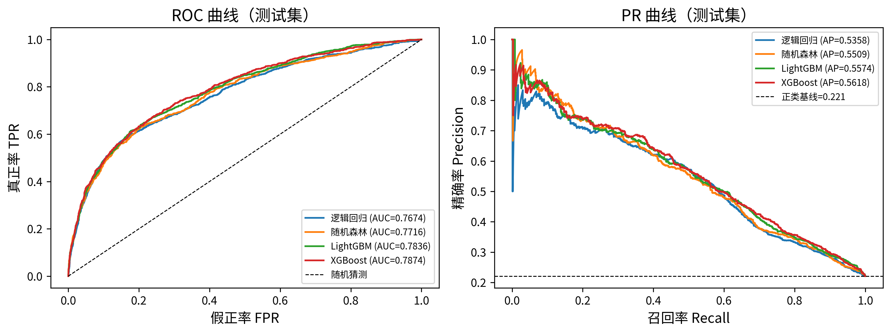

# 信用违约风险预测 —— 面向类别不平衡与代价敏感决策

基于客户信用额度、账期状态与还款记录，预测下个月是否发生信用卡违约（二分类）。
项目围绕**类别不平衡**（正类约 22%）与**误判代价不对称**（漏判违约的损失是误杀的 10 倍）展开：
比较三种不平衡处理策略、三种概率校准方式，并用**代价最小化**替代"阈值 0.5"做最终决策。

> **课程**：机器学习课程设计
> **作者**：祁震淼 · 20245627
> **班级**：人工智能 2403 班
> **专业**：人工智能
> **指导教师**：曹鹏

---

## 1. 问题定义

| 项目 | 内容 |
| --- | --- |
| 任务类型 | 表格型二分类 |
| 标签 | `default`：下月是否违约（1 = 违约） |
| 核心难点 | 正负样本失衡（22.1% : 77.9%）；两类错误代价不对称 |
| 主指标 | AUC、AP（PR-AUC）、F1、KS、Brier、ECE、期望误判成本与成本节省率 |
| 决策规则 | 在验证集上最小化期望误判成本选出阈值，而非固定 0.5 |

> 在不平衡任务上 Accuracy 会给出误导性结论（全部预测为负类即可达到 77.9%），
> 因此本项目不使用 Accuracy，主指标为 AP 与业务成本。

## 2. 数据集

| 项目 | 内容 |
| --- | --- |
| 名称 | Default of Credit Card Clients（UCI Machine Learning Repository, id=350） |
| 原始规模 | 30,000 行 × 24 列（23 个字段 + 标签） |
| 清洗后 | 29,965 行（剔除 35 条完全重复记录），缺失值 0 |
| 正负比 | 违约 22.13% : 未违约 77.87% |
| 数据质量问题 | EDUCATION 未文档化取值 345 处、MARRIAGE 未文档化取值 54 处（均归入"其他"）；账单金额为负 3,932 处（0.02%，视为退款，保留） |
| 特征工程 | 新增 20 个特征（账单均值/最大值/标准差、信用利用率、还款比、逾期次数统计等），总计 43 维特征 |
| 划分 | 分层 70% / 15% / 15%（train / val / test），`SEED=42` |

原始数据不纳入版本库，运行脚本自动下载：

```bash
python scripts/download_data.py     # 写入 data/raw/credit_default.csv
```

数据来源与字段说明见 [`data/README.md`](data/README.md)。

## 3. 运行环境

| 项目 | 配置 |
| --- | --- |
| CPU | 13th Gen Intel Core i5-13500H（16 线程） |
| 内存 | 14 GiB |
| GPU | 无（全流程 CPU 运行） |
| Python | 3.13.9 |
| 主要依赖 | lightgbm 4.7.0、xgboost 3.4.1、scikit-learn 1.7.2、imbalanced-learn 0.14.0、shap 0.54.1、pandas 2.3.3 |
| 并行度 | `n_jobs=6` |

完整依赖与版本见 [`requirements.txt`](requirements.txt)：

```bash
python -m venv .venv && source .venv/bin/activate
pip install -r requirements.txt
```

## 4. 目录结构

```text
.
├── src/                        # 核心代码包
│   ├── config.py               # 路径、随机种子、代价矩阵、阈值网格（唯一常量来源）
│   ├── data.py                 # 数据读取、清洗、特征工程、分层划分
│   ├── models.py               # 模型工厂、不平衡策略、校准与拟合管线
│   ├── train.py                # 单次训练与交叉验证
│   ├── evaluate.py             # 指标计算、ECE、最优阈值搜索
│   └── utils.py                # 随机种子、计时、结果落盘、绘图风格
├── scripts/
│   ├── download_data.py        # 数据获取 → data/raw/
│   ├── run_experiments.py      # 主线实验（模型 × 策略 × 5 种子）
│   ├── extra_calibration_imbalance.py  # 校准与不平衡策略补充分析
│   ├── extra_error_analysis.py # 高置信错误个案分析
│   └── run_all.sh              # 一键复现
├── results/
│   ├── figures/                # 插图（300 dpi，13 张）
│   ├── tables/                 # 结果表（csv + markdown）
│   └── metrics/                # 指标 json（81 次运行的完整记录）
├── data/README.md              # 数据说明（原始数据不入库）
├── report/                     # 报告与 PDF 构建脚本
├── tests/test_smoke.py         # 冒烟测试（合成数据跑通全链路）
├── _runs_log.md                # 运行日志：命令、耗时、分阶段记录
├── requirements.txt
└── LICENSE
```

## 5. 一键复现

```bash
# 全流程（约 8～9 分钟，CPU）
python scripts/download_data.py
python scripts/run_experiments.py
python scripts/extra_calibration_imbalance.py
python scripts/extra_error_analysis.py

# 或者一条命令
bash scripts/run_all.sh
```

## 6. 实测耗时

本机（16 线程 CPU、无 GPU、`n_jobs=6`）全量实验：

| 项目 | 数值 |
| --- | --- |
| 总耗时 | **505.5 秒**（约 8.4 分钟） |
| 运行次数 | **81 次**（模型 × 不平衡策略 × 5 种子 + 校准 + 消融） |
| 其中 SHAP 与混淆矩阵阶段 | 10.4 秒 |

分阶段耗时、每条命令与机器配置见 [`_runs_log.md`](_runs_log.md)。

## 7. 主要结果

代价矩阵 FN:FP = 10:1；阈值在验证集上按期望成本最小化选取；表中为 5 个随机种子的均值。

| 配置 | AUC | AP | Brier | ECE | 期望成本 | 成本节省率 | 选用阈值 |
| --- | --- | --- | --- | --- | --- | --- | --- |
| **LightGBM / class_weight** | 0.7835 | **0.5592** | 0.1614 | 0.1372 | 3136.0 | 31.20% | 0.14 |
| LightGBM / none | 0.7834 | 0.5572 | 0.1352 | **0.0216** | 3147.6 | 51.36% | 0.074 |
| LightGBM / smote | 0.7738 | 0.5358 | 0.1418 | 0.0434 | **3133.6** | 46.73% | 0.078 |
| 逻辑回归 / class_weight | 0.7686 | 0.5362 | 0.1866 | 0.2154 | 3305.0 | 25.38% | 0.25 |
| 逻辑回归 / none | 0.7674 | 0.5358 | 0.1378 | 0.0210 | 3340.0 | 53.02% | 0.09 |
| 随机森林 / class_weight | 0.7724 | 0.5413 | 0.1399 | 0.0402 | 3242.6 | 46.65% | 0.098 |
| 随机森林 / none | 0.7721 | 0.5500 | 0.1371 | 0.0201 | 3248.0 | 50.48% | 0.076 |

**主要结论**

1. **LightGBM 判别力最强**（AUC 0.7835 / AP 0.5592），明显优于逻辑回归与随机森林。
2. **代价敏感阈值是收益最大的一步**：相对固定 0.5 阈值，所有配置的期望成本下降 25%～53%。
3. **class_weight 提升判别力但破坏概率校准**：ECE 从 0.0216 恶化到 0.1372，因为预测概率被系统性放大。
   若下游要用概率本身做决策（而非只排序），应优先选 `none` + 单独校准。
4. **SMOTE 未带来收益**：在表格数据上，合成样本使 AP 下降（0.5592 → 0.5358），
   且真实业务成本更低仅体现为 3133.6 与 3136.0 的 0.1% 级差异，不值得引入额外复杂度。
5. **Sigmoid 校准在 LightGBM 上最稳**：ECE 0.0114、成本节省率 55.16%，优于 isotonic（过拟合小验证集）与原始概率。

> 完整结果（含 9 种配置 × 5 种子的均值±标准差、校准对比、消融实验、稳定性分析）见
> [`results/tables/`](results/tables/) 下的 `t05_main_results.md`、`t08_calibration.md`、
> `t10_ablation.md`、`t06_stability.md`。本文所有数字均由脚本输出后直接复制，未手工修改。

### 结果概览图



## 8. 结果文件索引

| 文件 | 内容 |
| --- | --- |
| `results/tables/t03_descriptive.md` | 描述统计 |
| `results/tables/t04_default_by_pay0.md` | 违约率与逾期等级的关系 |
| `results/tables/t05_main_results.md` | 主线结果：9 配置 × 5 种子 |
| `results/tables/t06_stability.md` | 跨种子稳定性 |
| `results/tables/t07_hyperparam_search.md` | 超参数搜索记录 |
| `results/tables/t08_calibration.md` | 三种校准方式对比 |
| `results/tables/t09_cost_sensitivity.md` | 代价矩阵敏感性（5:1 与 10:1） |
| `results/tables/t10_ablation.md` | 消融实验 |
| `results/tables/t11_shap_top20.md` | SHAP 全局重要性 Top-20 |
| `results/tables/t12_calibration_imbalance.md` | 校准 × 不平衡策略交叉 |
| `results/tables/t13_error_analysis.md` | 错误分布统计 |
| `results/tables/t14_error_cases.md` | 高置信错误个案 |
| `results/metrics/all_runs.json` | 81 次运行的完整指标 |
| `results/figures/f05_roc_pr.png` | ROC / PR 曲线 |
| `results/figures/f06_calibration.png` | 可靠性曲线（校准） |
| `results/figures/f07_threshold_cost.png` | 阈值—成本曲线 |
| `results/figures/f08_ablation.png` | 消融对比 |
| `results/figures/f09_shap_bar.png` | SHAP 全局重要性 |
| `results/figures/f10_shap_beeswarm.png` | SHAP 分布 |
| `results/figures/f11_shap_dependence.png` | SHAP 单特征依赖 |
| `results/figures/f12_confusion_matrix.png` | 混淆矩阵 |
| `results/figures/f13_error_cases.png` | 错误个案 |

## 9. 复现注意事项

1. **严禁数据泄漏**：SMOTE / 过采样只在训练折内进行，验证集与测试集始终保持原始分布。
2. **校准在验证集上拟合**，测试集只做评估，不参与任何参数选择。
3. **阈值搜索**在验证集上完成，`THRESHOLD_GRID` 覆盖 0.05～0.95。
4. 所有随机过程由 `src/config.py` 的 `SEED=42` 控制；稳定性分析额外跑 5 个种子并报告标准差。

## 10. 报告

课程设计报告位于 `report/` 目录（Word 与 PDF 两版）。由源文件重建 PDF：

```bash
bash report/build_pdf.sh tex      # 最终 PDF（矢量、字体嵌入）
```

## 11. 许可

本项目采用 [MIT License](LICENSE)。

## 12. 参考资料

1. Yeh, I. C., & Lien, C. H. (2009). The comparisons of data mining techniques for the predictive accuracy of probability of default of credit card clients. *Expert Systems with Applications*, 36(2), 2473–2480.
2. UCI Machine Learning Repository: Default of Credit Card Clients. <https://archive.ics.uci.edu/dataset/350/default+of+credit+card+clients>
3. scikit-learn 用户指南：概率校准与模型评估. <https://scikit-learn.org/stable/user_guide.html>
